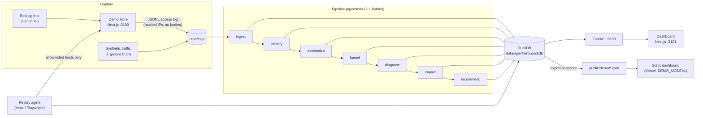

# Architecture

AgentLens reads server-side request logs, works out which visitors are AI agents, follows them through the purchase funnel,
finds why they fail, proves it with a replay, and puts a rupee value on each blocker.

## Components

| Component | Where | Notes |
|---|---|---|
| Demo store "Desi Threads" | `apps/store` | Next.js behind a custom `server.mjs` that logs every request. 16 friction toggles (F01-F16) in `apps/store/config/friction.json`, flipped at `/admin`. ADR-005. |
| Capture | `apps/store/lib/logger.ts` | Writes `data/logs/access-YYYY-MM-DD.jsonl` per [log-contract.md](log-contract.md). IP and session cookie are salted hashes. |
| Synthetic generator | `services/synth` | Offline (writes logs directly), live (drives the store) and a before/after scenario. Writes ground truth to `data/ground_truth/`, used only by evaluation. |
| Ingest | `services/api/ingest` | Incremental, idempotent (`request_id` primary key, per-file byte offsets). JSONL and nginx combined. Bad lines go to `ingest_errors`. |
| Identify | `services/api/identify` | Verified (Web Bot Auth signature check against operator key directories), Declared (`config/agents.yaml` UA registry), Suspected (behaviour score), Human. ADR-006. |
| Sessionize, funnel | `services/api/sessions`, `funnel.py` | Sessions split on an inactivity gap (30 min humans, 10 min agents) and carry the strongest identity; funnel stages from `config/funnel.yaml`. |
| Diagnose | `services/api/diagnosis` | Rules B01-B16 over terminal agent sessions (`config/blockers.yaml`, `config/diagnosis.yaml`), site probes, optional LLM classifier for unexplained failures (B99). [diagnosis.md](diagnosis.md), ADR-007. |
| Impact, recommend | `impact.py`, `recommend.py` | ₹ at risk = L x r x p_s x AOV x k with low/base/high bands and stored assumptions (ADR-007); fixes ranked by impact/effort. |
| Replay agent | `services/replay` | Re-runs a shopping task and returns confirmed / not reproduced / inconclusive with evidence. [replay-agent.md](replay-agent.md), ADR-009. |
| API | `services/api/main.py`, `routers/` | FastAPI over DuckDB; contract in [api-contract.md](api-contract.md). Single writer process: stop `serve` before running other CLI commands. |
| Dashboard | `apps/dashboard` | Next.js 15, Tailwind v4, Recharts. One data layer (`lib/data-source.ts`) switches between API, mocks and static demo (ADR-008). Theme in [theme.md](theme.md). |
| Report, before/after | `services/report`, `compare.py` | Agent Readiness Report (MD/HTML/PNG) and the Before/After comparison around a fix annotation ([before-after.md](before-after.md)). |
| Snapshot | `services/api/snapshot.py` | Calls the real API routes in-process and writes the static `/demo/*.json` layout. Fails on ground truth, raw IPs or e-mails. |

## Data flow and storage

- One DuckDB file, `data/agentlens.duckdb` (schema: `services/api/schema.sql`). Tables: `requests`, `request_signatures`,
  `sessions`, `session_stages`, `funnel_stats`, `blocker_hits`, `impact`, `impact_assumptions`, `recommendations`, `replays`,
  `site_checks`, `annotations`, `orders`, `key_cache`, `ingest_state`, `ingest_errors`, `ground_truth`, `runs`.
- Each pipeline step is a registered function (`pipeline.py`) whose result is recorded in `runs`; `run-all` runs them
  in order, and each step can be run alone (`agentlens ingest`, `identify`, ...).
- Configuration is data: `config/*.yaml` (agents, blockers, diagnosis thresholds, funnel, impact, replay, synth). The
  Settings API edits these files.
- `ground_truth` (loaded from the generator's files) is read only by the `eval*` commands. Identification and diagnosis never
  read it, and neither the API responses nor the snapshot expose it.

## Why these choices

| Decision | Why | ADR |
|---|---|---|
| Server logs, not JS tags | Most agents run no JavaScript, so a client-side tag never sees them | 005 |
| Three identification tiers + honest coverage metric | Only signed or declared agents can be named; the rest is probabilistic | 006 |
| Rule-based diagnosis first, LLM second | Reproducible and testable; LLM only for the unexplained remainder, mock by default | 001, 007 |
| DuckDB | One file, columnar, fast for 1M-line analytics on a laptop | 002 |
| Static snapshot for the public demo | No backend to host; read-only and synthetic by construction | 008 |
| Ports 3100 / 3101 / 8100 | Avoid common dev-server ports (3000, 8000) | 004 |

All ADRs are in [decisions/](decisions/).

## Testing and evaluation

- `pytest` (default markers): unit and API tests, plus the evaluation tests against ground truth.
- `agentlens eval` writes `data/eval/latest.json` (identification SC1-SC3, diagnosis SC4) shown on the dashboard.
- Dashboard: Vitest, Playwright against mocks, the real API and the static demo. Store: Vitest and Playwright e2e.
- Results and reproduction commands: [success-criteria.md](success-criteria.md), [performance.md](performance.md).
