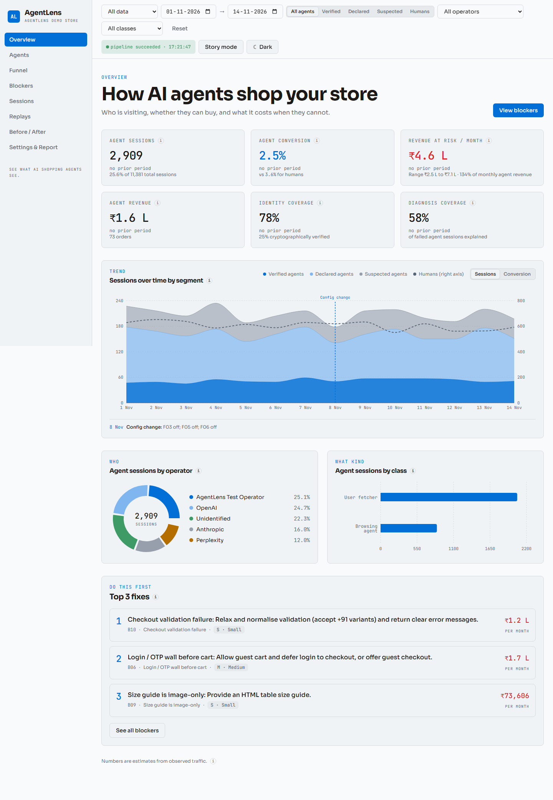
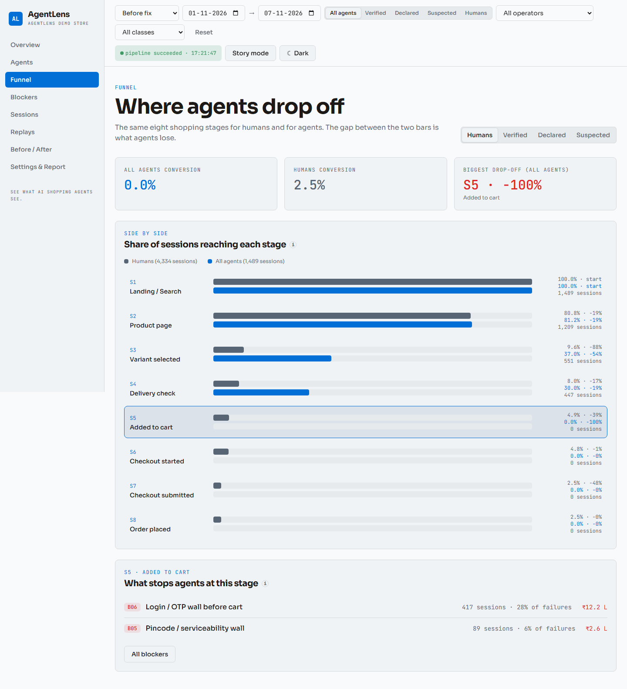
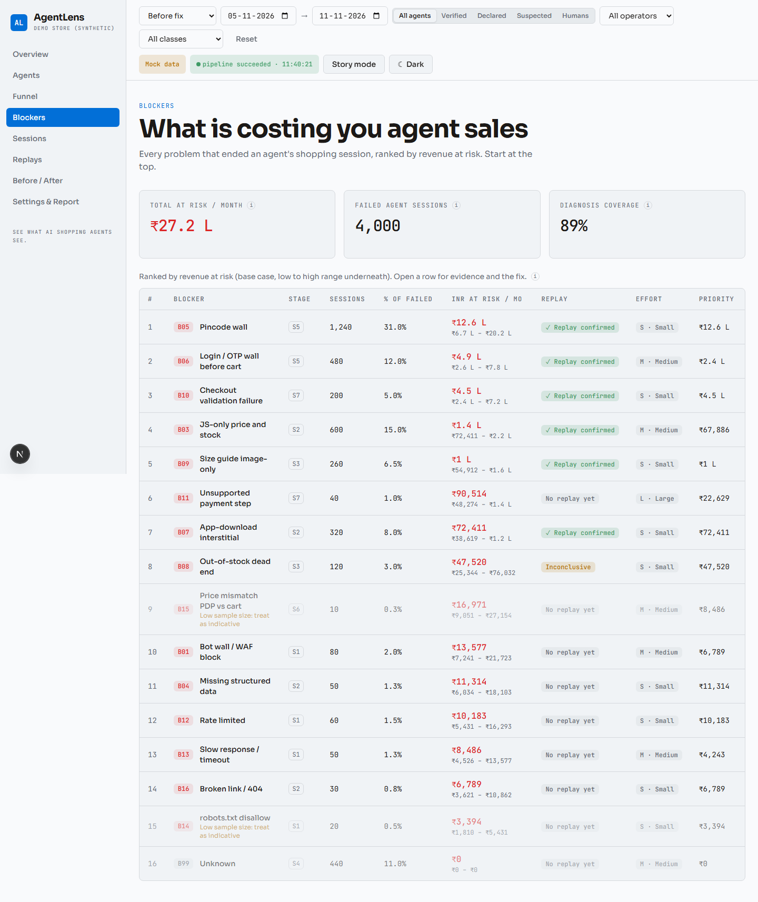
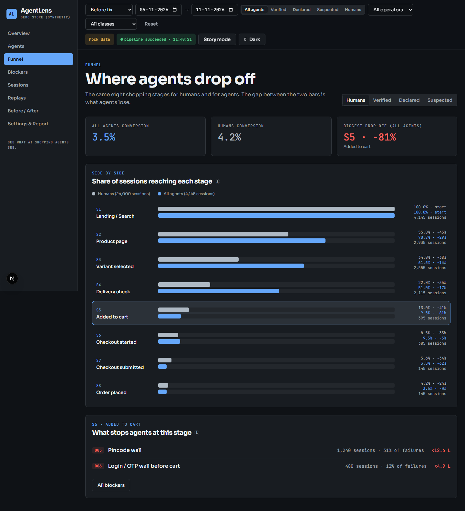
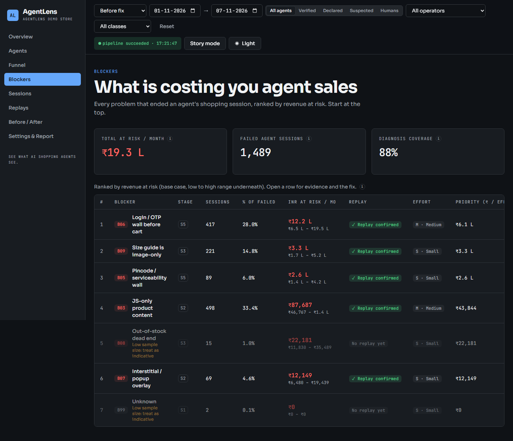
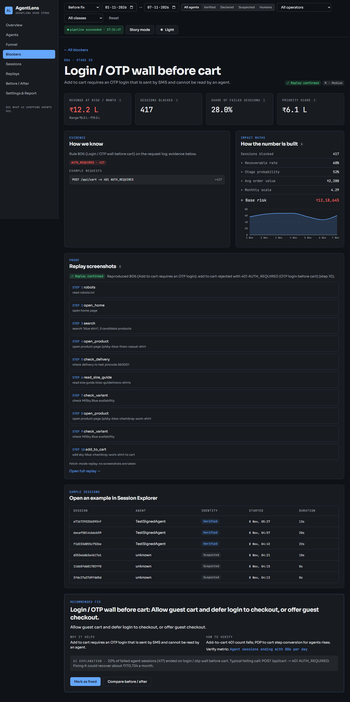

# AgentLens

**See what AI shopping agents see on your store, why they fail to buy, and what that costs you.**

AI agents (ChatGPT agent, Claude, Gemini, Perplexity and others) now browse and shop for people. Most of them never run
your analytics JavaScript, so they are invisible in GA4 and similar tools. AgentLens works from **server logs**: it spots
the agents, follows them through the purchase funnel, finds the blocker that ended each failed session, proves it with a
replay, and puts a rupee value on it.

<picture>
  <source media="(prefers-color-scheme: dark)" srcset="docs/screenshots/overview-dark.png">
  
</picture>

*Overview page on the bundled synthetic demo data. The funnel and blockers pages are further down.*

## The problem

- Agent traffic is growing, but analytics tools that rely on browser JavaScript do not see most of it.
- When an agent fails (a login wall, a pincode check, JavaScript-only content), nobody gets an error. The sale just does not happen.
- Store owners cannot tell which fix is worth doing first.

## What AgentLens does

1. **Identify** agents from logs in three tiers: **Verified** (valid Web Bot Auth signature, RFC 9421), **Declared**
   (user-agent matches a registry of known agents) and **Suspected** (behaviour only), plus **Human**.
2. **Diagnose** why failed agent sessions stopped, using 16 blocker rules (B01 to B16) and an optional LLM for the leftovers.
3. **Prove** the top blockers by replaying the journey against the store with a test client (`httpx` or Playwright).
4. **Price** each blocker in rupees (low / base / high range) and rank the fixes by impact and effort.
5. **Compare** before and after a fix, with a significance test, and export an Agent Readiness Report.

The demo store is **Desi Threads**, a Next.js shop in `apps/store` with toggleable friction (`/admin`) that produces
realistic blockers.

- Live demo: <https://agentlens.ptlabs.in> (read-only, synthetic data; the store is at <https://store.agentlens.ptlabs.in>).
  To host your own copy: [docs/deploy.md](docs/deploy.md).
- Demo video: not published yet. A 60-90 second shot list is in [docs/launch/video-script.md](docs/launch/video-script.md) and
  a 5-minute walkthrough script in [docs/demo-script.md](docs/demo-script.md).

## Quick start

Needs **Python 3.11+**, **Node.js 22+** and **pnpm** (`corepack enable`, or `npm i -g pnpm`). `uv` is installed by the
setup task. Docker is not required.

**Windows (PowerShell):**

```powershell
git clone https://github.com/prateektyagi2203/AgentLens.git
cd AgentLens
./tasks.ps1 setup            # creates .env, uv sync, pnpm install, Playwright Chromium
./tasks.ps1 synth-scenario   # synthetic logs + ground truth into ./data (6,000 sessions, 7 days Before + 7 days After)
./tasks.ps1 pipeline         # ingest -> identify -> sessionize -> funnel -> diagnose -> impact -> recommend
./tasks.ps1 dev              # store :3100, API :8100, dashboard :3101
```

**Linux / macOS** (needs GNU make, `python3`, `pnpm`):

```bash
git clone https://github.com/prateektyagi2203/AgentLens.git && cd AgentLens
make setup && make synth-scenario && make pipeline && make dev
```

Open <http://localhost:3101>. In the synthetic scenario the store's fixes go live on 8 Nov 2026: use the date filter
(or the **Before fix** preset) to compare 1-7 Nov with 8-14 Nov. Run the pipeline *before* `dev`: DuckDB allows a single
writer, so stop the API before running pipeline commands.

Other tasks: `test` (pytest + vitest), `lint` (ruff, mypy, eslint, tsc), `replay` (prove the top blockers against a running
store), `report` (Markdown / PDF / PNG report), `snapshot`, `demo`, `preview-demo`, `bench`, `clean-data`. Use them as
`./tasks.ps1 <task>` or `make <task>`.

Ports: store **3100**, dashboard **3101**, API **8100** ([ADR-004](docs/decisions/ADR-004-ports.md)).

### Static demo (no backend)

`./tasks.ps1 demo` (about 8 minutes) generates 12,000 synthetic sessions, runs the pipeline and the replays, exports the
public snapshot to `apps/dashboard/public/demo/*.json` and builds the dashboard as a static site in `apps/dashboard/out`.
`./tasks.ps1 preview-demo` serves it. The snapshot contains no ground truth and no raw IPs.

## Screenshots

Real dashboard against the real API (synthetic data). Light and dark themes.

| Funnel | Blockers |
|---|---|
|  |  |
|  |  |

Blocker detail: evidence, replay proof, the rupee maths and the recommended fix.



## Architecture

```text
Store (Next.js :3100) --JSONL logs--> ingest -> identify -> sessionize -> funnel -> diagnose -> impact -> recommend
Synthetic traffic -----JSONL logs-->            (Python CLI, DuckDB file)                |
Replay agent (httpx / Playwright) -- allow-listed hosts only --> store                    v
                                                                   FastAPI :8100 --> Dashboard (Next.js :3101)
                                                                   export-snapshot --> static demo (Vercel)
```

Details, data model and module map: [ARCHITECTURE.md](ARCHITECTURE.md).

## How identification works

| Tier | Evidence | Confidence |
|---|---|---|
| Verified | Valid HTTP Message Signature with a key from the operator's published key directory (Web Bot Auth, RFC 9421) | Cryptographic |
| Declared | User-agent matches the agent registry (`config/agents.yaml`) | Claimed by the client |
| Suspected | Behaviour: asset use, request timing, header shape, path patterns | Statistical |
| Human | Everything else | n/a |

**Honest limitation:** Agents that run inside the shopper's own browser (for example, browser extensions) look like humans at
the server. AgentLens can only flag them as Suspected through behaviour, if at all. The identity coverage metric shows how
much traffic is confidently identified.

Other limits: a Declared agent can be spoofed (the user-agent is only a claim), and Suspected accuracy on real traffic will
be lower than on the synthetic set. Method: [ADR-006](docs/decisions/ADR-006-web-bot-auth.md) and
[docs/diagnosis.md](docs/diagnosis.md).

## Blocker catalog

| ID | Blocker | ID | Blocker |
|---|---|---|---|
| B01 | Bot wall | B09 | Size guide is image-only |
| B02 | CAPTCHA | B10 | Checkout validation failure |
| B03 | JS-only product content | B11 | Unsupported payment method |
| B04 | Missing structured data | B12 | Rate limited |
| B05 | Pincode / serviceability wall | B13 | Slow response |
| B06 | Login / OTP wall before cart | B14 | robots.txt disallows the agent |
| B07 | Interstitial / popup overlay | B15 | Price mismatch |
| B08 | Out-of-stock dead end | B16 | Broken link |
| | | B99 | Unknown (LLM-assisted, optional) |

Rules and thresholds are in `config/blockers.yaml`.

## Evaluation

Measured on synthetic data with ground truth (the generator knows which sessions are agents and why they failed).
Real traffic will score lower, especially for the Suspected tier. Full table with reproduce commands:
[docs/success-criteria.md](docs/success-criteria.md).

| Metric | Target | Measured |
|---|---|---|
| Verified precision / false Verified on forged signatures | 100% / 0 | 100% / 0 |
| Declared accuracy | at least 98% | 100% |
| Suspected recall / human false-positive rate | at least 75% / at most 5% | 86.5% / 0.0% |
| Diagnosis precision / recall (golden set, 2,000 sessions) | at least 85% / 80% | 95.0% / 100% |
| Replay confirmation of top blockers | at least 80% | 6 of 6 |
| Pipeline: 1M log lines end to end | at most 3 min | 3 min 18 s (not met, see [performance](docs/performance.md)) |
| API p95, 1M-line database | at most 300 ms per endpoint | 282 ms worst case |

## Configuration

Copy `.env.example` to `.env` (the setup task does this). Every key is documented there; nothing needs changing for the demo.

| Variable | Purpose |
|---|---|
| `AGENTLENS_LLM_PROVIDER` | `mock` (default: deterministic, offline, no key) or `openai` ([ADR-001](docs/decisions/ADR-001-llm-provider.md)) |
| `OPENAI_API_KEY`, `AGENTLENS_LLM_MODEL` | Needed only for `openai` (default model `gpt-4o-mini`). Keep the key in `.env` or the shell, never in git |
| `AGENTLENS_IP_SALT` | Salt for the hashed IPs the store logs; change it for anything beyond the demo |
| `AGENTLENS_ADMIN_PASSWORD` | Password for the store `/admin` friction page |
| `AGENTLENS_DATA_DIR` | Where logs and `agentlens.duckdb` live (default `./data`) |
| `AGENTLENS_SITE_URL` | Store the pipeline probes for site-level blockers (unset = skipped) |
| `PUBLIC_STORE_HOST` | Tunnel host added to the replay allow-list for real-agent runs |
| `DEMO_MODE` | `1` = read-only store admin and API |

The LLM only classifies sessions the rules could not explain and writes the plain-language explanation. Without a key
everything runs, using the mock provider.

## Safety and ethics

- The replay agent is a test client for **your own store**. It visits only hosts on an allow-list
  (`config/replay.yaml`: `localhost:3100`, `127.0.0.1:3100`, `desithreads.local`, plus `PUBLIC_STORE_HOST`), reads and
  honours `robots.txt`, identifies itself as `AgentLens-Replay/1.0`, pauses between steps and caps a run at 50 replays.
- The store keeps **no request bodies** and logs only a salted hash of the IP address and cookie id. The public snapshot
  has no raw IPs and no ground truth. Details: [docs/replay-agent.md](docs/replay-agent.md), [SECURITY.md](SECURITY.md).
- Do not point AgentLens at a site you do not own or control.
- `apps/store/config/test-operator.private.pem` is a **deliberately public TEST key** for the fictional operator
  `agents.desithreads.test`. It protects nothing; see [apps/store/config/README.md](apps/store/config/README.md). No other
  secrets are committed.

## Known limitations

- The demo data is **synthetic**. Numbers in the dashboard and screenshots demonstrate the method, not real market behaviour.
- In-browser agents are mostly invisible (see above). Suspected-tier precision and recall on real traffic are untested.
- Rupee impact is an estimate from observed traffic (ranges shown), not a counterfactual measurement.
- The 1M-line pipeline benchmark takes about 3 min 18 s on the test laptop, slightly over the 3-minute target.
- Docker files and the Makefile are provided but untested (the author develops on Windows without Docker).
- Real-agent runs through a tunnel are a manual step: [docs/real-agent-runs.md](docs/real-agent-runs.md).
- Single store, single tenant, no authentication on the API (it is meant to run locally or behind your own proxy).

## Roadmap

Real vendor key directories in the verifier, live log tailing, Shopify and Cloudflare log connectors, more blocker rules,
multi-store support.

## Documentation

[ARCHITECTURE.md](ARCHITECTURE.md) | [PRD](docs/PRD.md) | [API contract](docs/api-contract.md) | [log contract](docs/log-contract.md) |
[diagnosis](docs/diagnosis.md) | [replay agent](docs/replay-agent.md) | [before/after](docs/before-after.md) |
[performance](docs/performance.md) | [success criteria](docs/success-criteria.md) | [deploy](docs/deploy.md) |
[demo script](docs/demo-script.md) | [real-agent runs](docs/real-agent-runs.md) | [decisions (ADRs)](docs/decisions) |
[CHANGELOG](CHANGELOG.md)

## Contributing and licence

See [CONTRIBUTING.md](CONTRIBUTING.md). Report security issues as described in [SECURITY.md](SECURITY.md).
Licensed under the [MIT licence](LICENSE).

## About the author

Built by Prateek Tyagi, a product manager who builds. The PRD in [docs/PRD.md](docs/PRD.md) is part of the project.
